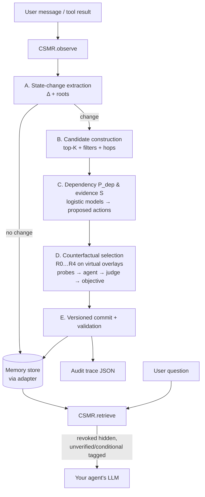

# CSMR — Counterfactual Selective Memory Repair

**Keeping an LLM agent's long-term memory consistent when the world changes — by repairing only what actually needs repair.**

CSMR is a memory-maintenance layer for LLM agents. When a user (or a tool) reports a change — *"I sold my car"*, *"I moved to Pune"*, *"I quit my job"* — CSMR finds the stored memories that the change makes stale, decides what to do with each one, and commits a minimal, versioned repair. It sits between your agent and your memory store, so the agent keeps its own model, prompts and database.

> Research prototype developed as a B.Tech project at IIIT Pune. Evaluation is in progress; see [Evaluation](#evaluation).

---

## Contents

- [The problem](#the-problem)
- [How CSMR works](#how-csmr-works)
- [Architecture](#architecture)
- [Repair actions](#repair-actions)
- [The selection objective](#the-selection-objective)
- [Design principles](#design-principles)
- [Technologies](#technologies)
- [Installation](#installation)
- [Usage](#usage)
- [Integrating with your agent](#integrating-with-your-agent)
- [Configuration](#configuration)
- [Project structure](#project-structure)
- [Evaluation](#evaluation)
- [Limitations](#limitations)
- [Citation](#citation)

---

## The problem

Long-term memory lets agents personalise across sessions, but stored facts go stale. Existing approaches tend to fail in one of two directions:

| Failure | Example (user says *"I sold my car"*) |
|---|---|
| **Under-repair** — only the directly contradicted fact is updated | "owns a car" is fixed, but "drives to work by car" survives, so the agent still says *"you drive to work"* |
| **Over-repair** — everything semantically similar is changed | "prefers driving" and "likes car-racing games" are wrongly deleted, although selling a car doesn't make them false |

Append-only stores keep both the old and new facts and leave the agent to sort out the conflict; recency rules and similarity thresholds are too coarse to separate *dependent* memories from merely *related* ones.

CSMR treats this as a selection problem: **which subset of memories should change, and how, so the agent's future behaviour is correct while unrelated memories stay untouched?**

---

## How CSMR works

Every new observation goes through five phases.

| Phase | Name | What it does |
|---|---|---|
| **A** | State-change extraction | Turns the observation into a structured change Δ = (entity, attribute, old, new, time, source, confidence) and finds the **root** memories it directly contradicts. Messages that only confirm or add compatible facts are stored but trigger no repair. |
| **B** | Candidate construction | Builds a permissive candidate set *C*: embedding retrieval with entity/attribute filters, plus 1–2 hop expansion from the roots. Memories outside *C* are never touched. |
| **C** | Dependency & evidence assessment | For each candidate, a logistic model estimates **P(dependency)** — does its validity depend on the changed fact? — and a second estimates **evidence sufficiency S** — is the observation strong enough to justify changing it? Together they propose an action per memory. |
| **D** | Counterfactual repair-set selection | Builds alternative repair sets (from "change nothing" to "broad propagation"), applies each to a **virtual copy** of memory, lets the agent answer automatically generated probe questions under each copy, and scores each set with the objective below. The best feasible set wins. |
| **E** | Minimal commit & validation | Commits the chosen set with full versioning (nothing is ever deleted), re-runs the probes on the real store to confirm the outcome, and writes an audit trace. |

### Worked example

Memory before: *M1* owns a car · *M2* drives to work by car · *M3* spends money on fuel · *M4* prefers driving · *M5* likes Italian food.
Observation: **"I sold my car."**

| Memory | Dependency | Evidence | Action |
|---|---|---|---|
| M1 owns a car | root | strong | **REVOKE** |
| M2 drives to work by car | strong | strong | **REVISE** → "previously drove to work by car; current commute unknown" |
| M3 spends money on fuel | likely | weak | **VERIFY** (flagged, not changed) |
| M4 prefers driving | weak | — | **KEEP** |
| M5 likes Italian food | not a candidate | — | **KEEP** |

Repairing only M1 (*R1*) leaves the agent answering "by car"; changing everything (*R4*) destroys a valid preference. CSMR's counterfactual stage measures this and picks the middle set (*R2*).

---

## Architecture



Key components:

- **Memory store adapter** — CSMR never talks to a database directly. Any backend that implements a small interface (`all`, `get`, `search`, `add`, `update`, `snapshot`) can be used. An in-memory/JSON adapter is included.
- **Overlay** — repair sets are evaluated on lightweight virtual views of the store, never on copies or the live data. The same rendering is used for evaluation and for the committed store, so what was scored is exactly what the agent later sees.
- **Downstream agent** — a minimal retrieval-QA agent that answers only from retrieved memories (or says *unknown*). It is used to measure the effect of each candidate repair.
- **LLM layer** — one wrapper for all model calls: disk cache, temperature 0, JSON mode, retries, provider-error handling and logged fallbacks.

---

## Repair actions

| Action | Meaning | Effect at retrieval time |
|---|---|---|
| `KEEP` | Still valid | Shown as-is |
| `VERIFY` | Possibly stale, evidence too weak to change | Shown tagged `[unverified]`; added to a pending-verification queue |
| `CONDITIONAL` | Valid only under a condition (e.g. a temporary change) | Shown with `(only valid if: …)` |
| `REVISE` | Rewritten to reflect the change while preserving history | Shown with the new text |
| `REVOKE` | No longer true | Hidden from retrieval (kept in history) |

Two hard constraints are always enforced:

1. A memory outside the candidate set is always `KEEP`.
2. `REVISE` / `REVOKE` require evidence sufficiency **S ≥ τₑ** — weak evidence can flag a memory but never change it.

---

## The selection objective

For each feasible repair set *R*:

$$
R^\* = \arg\max_{R}\;\; \text{Benefit}(R) \;-\; \lambda_c\,\text{Collateral}(R) \;-\; \lambda_e\,\text{EvidenceCost}(R) \;-\; \lambda_s\,|R|
$$

- **Benefit** — mean judge score of the agent's answers to probe questions under *R* (consistent = 1, vague = 0.5, contradicted by the change = 0).
- **Collateral** — Σ (1 − P_dep) over memories *R* revises or revokes: the risk of damaging memories that don't actually depend on the change.
- **EvidenceCost** — the cost of verification requests and extra model calls.
- **|R|** — number of non-KEEP actions (minimality).

Probe questions are generated by the system from Δ and the candidates only — neutral questions about the user's *current* state that never mention the change. No labelled data is used at decision time.

---

## Design principles

- **Minimal and selective** — prefer the smallest repair that fixes behaviour; leave unrelated memories alone.
- **Evidence-aware** — hedged, third-party or temporary statements lead to `VERIFY` / `CONDITIONAL`, not destructive edits.
- **Non-destructive** — every change pushes the previous version into history and bumps the version number.
- **Auditable** — every `observe()` call returns a trace: Δ, candidates with all features, every repair set with its score breakdown, the chosen set, version transitions and model-call statistics.
- **Backend-agnostic** — works with any OpenAI-compatible LLM endpoint and any memory store behind the adapter interface.
- **Cheap on ordinary turns** — most messages contain no state change, so the expensive counterfactual stage runs only when needed.

---

## Technologies

| Purpose | Technology |
|---|---|
| Language | Python 3.10+ |
| LLM access | `openai` client against any OpenAI-compatible endpoint (OpenAI, Groq, OpenRouter, Together, local Ollama) |
| Embeddings | `sentence-transformers` — `all-MiniLM-L6-v2` |
| Natural-language inference | `transformers` cross-encoder — `cross-encoder/nli-deberta-v3-small` |
| Dependency & evidence models | `scikit-learn` logistic regression |
| Validation / config | `pydantic`, `pyyaml`, `python-dotenv` |
| Caching | `diskcache` |
| Analysis | `numpy`, `pandas`, `matplotlib` |
| Testing | `pytest` |

No vector database is required: per-user stores are small, so similarity is computed directly with NumPy.

---

## Installation

```bash
git clone <your-repo-url> csmr
cd csmr
python -m venv .venv
source .venv/bin/activate          # Windows: .venv\Scripts\activate
pip install -r requirements.txt
cp .env.example .env               # then edit .env
```

`.env` holds the LLM endpoint:

```env
LLM_BASE_URL=https://api.groq.com/openai/v1    # or http://localhost:11434/v1 for Ollama
LLM_API_KEY=your-key
```

Set the model name in `config.yaml` under `llm.model`. The embedding and NLI models download automatically on first use.

---

## Usage

### Interactive demo

```bash
python examples/chat_agent.py [scenario.json]    # default: data/dev/car_sale_distractors.json
```

A line ending in `?` is a question to the agent; any other line is an observation. The scenario file only seeds the store. An empty line quits.

```
25 memories loaded. State a change, or ask a question ('?' at the end).
you> I own a car and drive to work every day
stored OBS26: The user owns a car and drives to work every day.
delta: no change
you> I sold my car
stored OBS27: The user sold their car.
delta: user.vehicle_ownership: 'car' -> 'None' (remove)
chosen set: R2 | repairs: {'M1': 'REVOKE', 'M2': 'REVISE', 'M3': 'VERIFY', ...}
  pending verification: M3: The user spends money on fuel.
you> How do I get to work?
agent> unknown
```

### Command line

Run the full pipeline on a scenario file and print the decision. A scenario is a JSON file with `memories` (each with `id`, `text`, `entity`, `attribute`, `time`, optional `source`) and an `observation` (`text`, `source`, `time`); see `data/dev/car_sale.json`.

```bash
python run.py data/dev/car_sale.json
python run.py data/dev/car_sale.json --trace out/car_sale.json     # save the full audit trace
python run.py data/dev/car_sale.json --set lambda_c=0.25 --set ablation.use_evidence=false
```

### Python API

```python
from csmr.api import CSMR
from csmr.adapters.memory import InMemoryAdapter

# my_memories.json: a JSON list of memories, e.g.
# [{"id": "M1", "text": "The user owns a car.", "entity": "user", "attribute": "vehicle_ownership",
#   "time": "2026-03-01T10:00:00", "source": "user"}, ...]
memory = CSMR(InMemoryAdapter.from_json("my_memories.json"))     # optional 2nd arg: config path or dict

trace = memory.observe("I sold my car", source="user")           # -> Trace
print(trace.chosen, trace.final_actions)

context = memory.retrieve("How do I get to work?", k=5)          # -> list[str]; revoked hidden, others tagged
memories = memory.retrieve_memories("How do I get to work?")     # -> list[Memory], same filtering
pending = memory.pending_verifications()                         # -> list[Memory] awaiting confirmation
```

`observe(text, source="user", time=None)` stamps the current time when `time` is omitted. Text ending in `?` is treated as a question: nothing is stored and an empty trace is returned.

---

## Integrating with your agent

CSMR needs two calls per turn:

```python
def agent_turn(user_msg: str) -> str:
    memory.observe(user_msg)                  # stores statements; repairs only if something changed; ignores questions
    context = memory.retrieve(user_msg, k=5)  # repair-aware retrieval
    return my_llm.reply(user_msg, context)
```

To use your own storage, implement the adapter interface in `csmr/adapters/base.py`:

```python
class MemoryStoreAdapter(ABC):
    def all(self, entity=None, include_revoked=False) -> list[Memory]: ...
    def get(self, memory_id) -> Memory: ...
    def search(self, query, k) -> list[Memory]: ...
    def add(self, memory) -> None: ...
    def update(self, memory_id, *, text=None, status=None, condition=None,
               clear_condition=False, reason="") -> Memory: ...   # must keep history
    def snapshot(self) -> "MemoryStoreAdapter": ...
```

**Handling `VERIFY`.** `pending_verifications()` returns memories that may be stale. Until then they are shown to the agent tagged `[unverified]`. The agent can ask the user to confirm ("Do you still spend on fuel, maybe for another vehicle?"); the reply is just another `observe()` call, which can then revise or revoke the flagged memory through the normal pipeline.

---

## Configuration

All tunables live in `config.yaml` — nothing is hard-coded. The most important:

| Key | Meaning |
|---|---|
| `llm.model`, `llm.judge_model` | Models used for extraction, probes, answering and judging |
| `top_k`, `max_hops`, `hop_sim`, `topk_min_sim` | Candidate construction |
| `tau_d`, `tau_e` | Dependency and evidence thresholds |
| `dependency_weights`, `evidence_weights` | Logistic-model coefficients (replaced by fitted models in `models/` when present) |
| `lambda_c`, `lambda_e`, `lambda_s` | Objective weights |
| `n_probes` | Probe questions per decision |
| `ablation.use_dependency`, `use_evidence`, `use_counterfactual`, `use_minimality` | Switch off a stage (each falls back to its trivial default) |

Any key can be overridden for a single run with `--set key=value`.

---

## Project structure

```
csmr/
  api.py                 public CSMR class: observe, retrieve, pending_verifications
  types.py               Memory, Observation, StateChange, Action, CandidateInfo, RepairSet, Trace
  scenario.py            scenario-file loader
  llm.py                 cached, fault-tolerant LLM wrapper
  models.py              embedding and NLI models
  config.py              configuration loading and overrides
  adapters/              store interface + in-memory/JSON adapter
  pipeline/
    extract.py           Phase A
    candidates.py        Phase B
    dependency.py        Phase C — dependency model
    evidence.py          Phase C — evidence model
    actions.py           proposed actions, revision / condition text
    repair_sets.py       Phase D — repair-set generation and feasibility
    overlay.py           virtual views and shared rendering
    agent.py             downstream retrieval-QA agent
    counterfactual.py    Phase D — probes, judge, objective, selection
    commit.py            Phase E — versioned commit and validation
    run.py               end-to-end orchestration
baselines/               comparison methods (in progress)
eval/                    evaluation code (diagnostics so far; metrics and runners in progress)
models/                  fitted dependency/evidence models (dependency.json, evidence.json), when present
data/dev/                hand-written development scenarios
examples/chat_agent.py   interactive terminal demo
run.py                   command-line entry point
config.yaml              all tunable parameters
tests/                   unit, real-LLM, integration, leakage and config tests
```

### Tests

```bash
pytest -q -m "not llm"     # fast tests, no model calls
pytest -q -m llm           # tests against the real LLM (needs .env)
```

The suite includes guards that fail if any pipeline code reads evaluation labels, or if code reads a configuration key that `config.yaml` doesn't define.

---

## Evaluation

CSMR is evaluated on a benchmark of memory-repair scenarios covering eight categories — direct contradiction, 1-/2-/3-hop dependency, false semantic similarity, weak or hedged evidence, conflicting sources and temporary changes — across ten life domains, with distractor memories so retrieval is realistic. Test scenarios are human-verified.

**Metrics:** repair precision and recall, over-invalidation (valid memories wrongly changed), under-repair (stale memories left in place), 5-way action accuracy, downstream question-answering accuracy, persistence across later turns, and cost (model calls, latency).

**Baselines:** append-only, recency, last-write-wins, similarity-threshold propagation, dependency-only, evidence-only, and a single-prompt LLM that decides all actions at once.

**Ablations:** each stage (dependency, evidence, counterfactual selection, minimality) switched off in turn, plus a sweep over λ_c showing the repair-recall vs. over-invalidation trade-off.

*Results will be added here.*

---

## Limitations

- Decisions depend on the underlying LLM; small models extract state changes and judge answers noticeably less reliably.
- Single-turn probes cannot reward `VERIFY` / `CONDITIONAL`, whose value appears in later turns; persistence metrics are used to capture this.
- When the new observation is retrieved alongside a stale memory, capable models often reconcile the conflict themselves, so the benefit of repair grows with store size and conversation length.
- The LLM-based causal cue is sensitive to prompt wording; its contribution is calibrated by the learned dependency model.

---

## Citation

```bibtex
@misc{csmr2026,
  title  = {Counterfactual Selective Memory Repair for LLM Agents},
  author = {<Team members>},
  year   = {2026},
  note   = {B.Tech project, IIIT Pune}
}
```

## License

<Add a license, e.g. MIT.>
